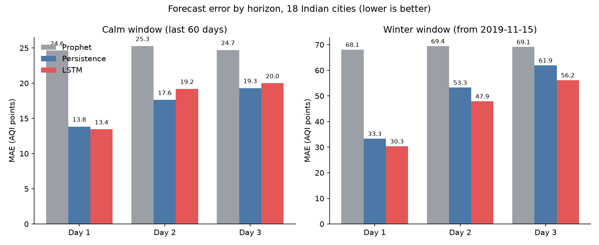

# AQI Forecast India

Short-term air quality forecasting for Indian cities. The project predicts the daily AQI for the next 1, 2 and 3 days in 18 cities and compares three models on identical test rows:

- **Persistence**: repeats the last observed AQI. This is the baseline any model has to beat.
- **Prophet**: one model per city, with yearly and weekly seasonality.
- **LSTM**: one shared model for all 18 cities.

## Data

Daily city-level readings of AQI and six pollutants (PM2.5, PM10, NO2, SO2, CO, O3), cleaned into `data/processed/aqi_clean.csv`. The data runs to 2020-07-01. The 18 cities with enough history are the "full" tier in `data/processed/city_summary.csv`.

## Method

**Backtest.** Each test window is 60 days with a forecast origin every 3 days. At each origin every model forecasts days 1, 2 and 3 ahead. All models are trained only on data up to the start of the window, and all are scored on the same rows.

**Prophet.** Fitted per city on data up to the window start, with yearly and weekly seasonality.

**LSTM.** One LSTM (64 units, dropout 0.2, dense layer of 32) serves all cities. Input is the last 14 days of AQI and pollutants plus time of year (sine and cosine of day of year). Each city is scaled with its own statistics so cities are comparable. The model predicts the change from today's AQI, so it starts from the persistence baseline and has to learn improvements on top of it. Training uses Huber loss with early stopping on a 45-day validation period.

## Results

Two windows were tested: a calm window (May to June 2020) and a winter window starting 2019-11-15, when pollution is at its worst. Lower MAE is better.

### Calm window (1039 forecasts)

| Model | MAE | RMSE |
|---|---|---|
| Prophet | 24.9 | 36.8 |
| Persistence | 16.9 | 29.0 |
| LSTM | 17.5 | 28.4 |

| Forecast day | Prophet | Persistence | LSTM |
|---|---|---|---|
| Day 1 | 24.6 | 13.8 | 13.4 |
| Day 2 | 25.3 | 17.6 | 19.2 |
| Day 3 | 24.7 | 19.3 | 20.0 |

The LSTM beats persistence in 12 of 18 cities, but persistence has the lower overall MAE because of large misses in Ahmedabad and Talcher.

### Winter window (1078 forecasts)

| Model | MAE | RMSE |
|---|---|---|
| Prophet | 68.9 | 94.5 |
| Persistence | 49.5 | 79.6 |
| LSTM | 44.8 | 70.0 |

| Forecast day | Prophet | Persistence | LSTM |
|---|---|---|---|
| Day 1 | 68.1 | 33.3 | 30.3 |
| Day 2 | 69.4 | 53.3 | 47.9 |
| Day 3 | 69.1 | 61.9 | 56.2 |

The LSTM has the lowest error overall and on every forecast day, and its lead grows with the horizon. It beats persistence in 13 of 18 cities. It loses to persistence in Bengaluru, Chennai and Patna.



### Summary

- Prophet is the weakest model in both windows and rarely beats persistence.
- In calm weather the LSTM and persistence are roughly tied.
- In winter the LSTM is clearly better than persistence.

## Limitations

- Each result comes from one 60-day window with 20 forecast origins per city, so the differences are encouraging but not conclusive.
- The calm window overlaps the COVID-19 lockdown period, which may make it atypical.
- Prophet had less than two years of history for five cities in the winter window (Amaravati, Brajrajnagar, Mumbai, Talcher, Kolkata), so its yearly seasonality is unreliable there.
- LSTM validation loss stopped improving after a few epochs in both runs, so the model overfits quickly.
- Ahmedabad is very hard for every model in winter.

## Project structure

```
data/processed/   cleaned data, city summary and backtest outputs
models/           LSTM scaling statistics (lstm_stats.json)
results/          charts
src/train_lstm.py         trains the LSTM and runs the calm-window comparison
src/backtest_winter.py    runs all three models on the winter window
src/plot_results.py       draws the MAE-by-forecast-day chart
```

## Running

```
pip install -r requirements.txt
python src/train_lstm.py
python src/backtest_winter.py
python src/plot_results.py
```

The trained model file `models/lstm_aqi.keras` is excluded by `.gitignore`, so it is not in the repository. Running `src/train_lstm.py` recreates it. `src/backtest_winter.py` trains its own LSTM in memory and does not save a model.